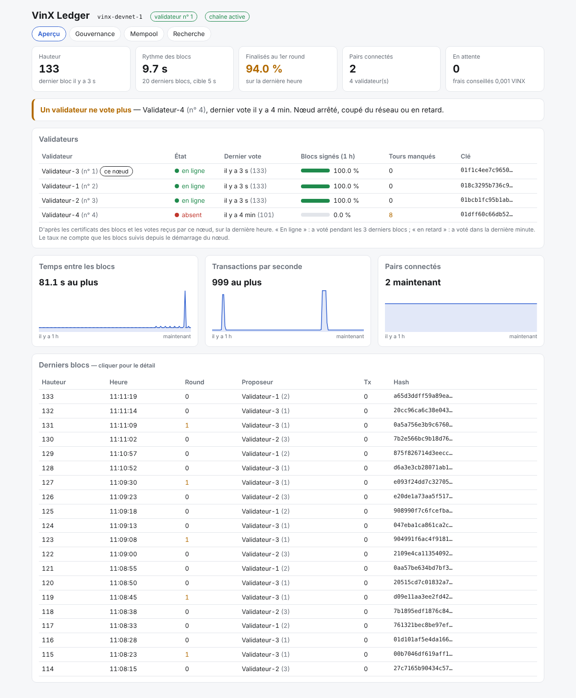

# Guide d'exploitation

Ce guide décrit comment déployer, observer et administrer un réseau VinX
Ledger. Les règles du protocole sont dans [`SPEC.md`](../SPEC.md) ; ce document
ne les répète pas.

## 1. Architecture recommandée

| Rôle | Nombre | Où |
|---|---|---|
| Validateurs | 4 | Quatre serveurs chez **au moins deux hébergeurs différents** |
| Nœud archive (et plus tard nœud public) | 1 | Un cinquième serveur, ou l'un des validateurs |
| Signataires admin | 3 clés | Trois supports distincts **hors des serveurs**, dont un hors ligne |

- Avec 4 validateurs, la chaîne tolère la perte d'un serveur. À deux serveurs
  perdus, elle s'arrête sans jamais diverger, et repart dès que l'un revient.
- Les clés admin ne doivent jamais se trouver sur un serveur : elles servent à
  la trésorerie, à l'escrow et aux validateurs, et ne sont utilisées que
  ponctuellement depuis ton poste.
- Gardez au moins un nœud `--archive` : sans lui, l'historique antérieur à la
  fenêtre de conservation (24 h) n'existe plus nulle part.

**Serveur type** : 2 vCPU, 4 Go de RAM, 40 Go de SSD, Ubuntu LTS ou Debian
stable.

## 2. Ports et pare-feu

| Port | Usage | Exposition |
|---|---|---|
| 26656/tcp | Réseau P2P | Ouvert **uniquement** aux adresses IP des autres nœuds |
| 8545/tcp | API et tableau de bord | **Jamais** exposé : `127.0.0.1` seulement |
| 9090, 3000/tcp | Prometheus, Grafana | `127.0.0.1` seulement |

Pour consulter un serveur depuis ton poste, passe par un tunnel SSH :

```bash
ssh -L 8545:127.0.0.1:8545 -L 3000:127.0.0.1:3000 admin@validateur-1
# puis ouvrir http://127.0.0.1:8545 (tableau de bord) et http://127.0.0.1:3000 (Grafana)
```

En plus de ce pare-feu, chaque nœud n'accepte que les pairs de sa liste
autorisée (SPEC §8.1).

## 3. Lancement d'un réseau

La procédure pas à pas, d'un validateur à quatre, est dans
[`DEPLOYER-UN-VALIDATEUR.md`](./DEPLOYER-UN-VALIDATEUR.md). Sur chaque
serveur, `deploy/install-validator.sh` fait le travail :

- `prepare` crée l'utilisateur `vinx`, la clé chiffrée du validateur avec un mot
  de passe aléatoire (`/etc/vinx/key-password`, lu par systemd via
  `LoadCredential`) et la clé réseau ; il affiche la clé publique et l'adresse
  réseau du nœud ;
- `start genesis.json [--archive] [--peer …]` installe la genèse, les options
  (`/etc/vinx/vinx-node.env`) et le service durci, puis vérifie que le nœud
  répond ;
- `upgrade` met à jour le binaire et revient de lui-même à l'ancien si le
  nœud ne finalise plus de bloc (guide, section 8).

Pour un nœud **observateur** (sans clé), retire la ligne `--key` du service
avec `systemctl edit --full vinx-node`.

### 3.1 Installer la supervision

Sur chaque serveur (Docker requis) :

```bash
cd deploy/monitoring && docker compose up -d
```

Grafana est provisionné avec le tableau de bord « VinX Ledger » ; crée ton
compte administrateur à la première connexion. Les alertes sont évaluées par
Prometheus ; pour les recevoir par e-mail, Telegram ou autre, ajoute un
Alertmanager (non fourni).

## 4. Observer

### 4.1 Tableau de bord du nœud



`http://127.0.0.1:8545/` (par le tunnel SSH) affiche en continu :
hauteur et âge du dernier bloc, rythme des blocs, taux de finalisation au
premier round, pairs, transactions en attente, frais conseillés, trésorerie,
escrow et prochaine tranche, multisig, validateurs, paramètres, derniers blocs,
et une recherche de compte. Les alertes (chaîne à l'arrêt, équivoque)
s'affichent en rouge en haut de page.

### 4.2 En ligne de commande

```bash
vinx-wallet status            # chaîne, hauteur, frais, nonce admin
vinx-wallet admin status      # multisig, validateurs, paramètres, escrow, trésorerie
vinx-wallet balance vinx1…
```

### 4.3 Indicateurs à surveiller

| Indicateur | Valeur saine | Si ce n'est pas le cas |
|---|---|---|
| Âge du dernier bloc | < 3 intervalles | §6.2 |
| Finalisés au 1er round | ≥ 99 % | réseau lent ou validateur défaillant ; ne pas réduire l'intervalle |
| Pairs connectés (validateur) | nombre de validateurs − 1 | pare-feu, options `--peer` |
| Preuves d'équivoque | 0 | §6.3, immédiatement |
| Transactions en attente | faible | afflux ou spam ; envisager de relever `min_fee` |

### 4.4 Alertes Prometheus

| Alerte | Gravité | Procédure |
|---|---|---|
| `VinxNoeudInjoignable` | critique | §6.1 |
| `VinxChaineArretee` | critique | §6.2 |
| `VinxEquivoque` | critique | §6.3 |
| `VinxPairsManquants` | avertissement | §6.1 |
| `VinxRoundsSupplementaires` | avertissement | §6.1 |
| `VinxMempoolEncombre` | avertissement | §5.4 |
| `VinxTrancheLiberable` | information | §5.1 |

Les règles sont testées : `promtool test rules deploy/monitoring/alerts.test.yml`.

## 5. Administrer

Toute action admin suit le même circuit, depuis ton poste :

1. `vinx-wallet admin propose --out p.json <action> …` prépare la proposition ;
2. chaque signataire la relit (`vinx-wallet admin show --file p.json`) puis
   l'approuve sur sa machine : `vinx-wallet admin approve --file p.json --key admin.json --index <i>` ;
3. dès que deux approbations sont réunies : `vinx-wallet admin submit --file p.json`.

Toutes les commandes ci-dessous prennent `--node http://127.0.0.1:8545` (par le
tunnel SSH). Les montants sont en VINX.

### 5.1 Libérer une tranche d'escrow

```bash
vinx-wallet admin propose --out p.json escrow-release --amount 7500000
```

Seule la première tranche échue est libérable, et au plus son montant. Ce qui
n'est pas libéré repart en fin de calendrier (SPEC §4.2). Pour renvoyer des
VINX de la trésorerie dans l'escrow : `escrow-return --amount …`.

### 5.2 Payer depuis la trésorerie

```bash
vinx-wallet admin propose --out p.json treasury-transfer --to vinx1… --amount 250 --memo "subvention"
```

### 5.3 Ajouter ou retirer un validateur

Ajouter :

1. installe le nouveau serveur et démarre-le **avec sa clé de validateur**
   (`install-validator.sh prepare` puis `start`). Tant qu'il n'est pas dans l'ensemble, il suit la chaîne sans voter ;
2. ajoute-le aux `--peer` des autres nœuds, et inversement ;
3. vérifie qu'il est prêt :
   `vinx-wallet --node <un nœud du réseau> preflight --new-node <son API>` ;
4. envoie le `add-validator` affiché par `preflight` (proposition, deux
   approbations, envoi). Deux blocs après son inclusion, le nœud se met à
   voter de lui-même, **sans redémarrage**.

Pour passer de 1 à 4 validateurs, ajoute les trois **ensemble** : à 2 ou 3
validateurs, la panne d'un seul arrête la chaîne. `preflight` accepte plusieurs
`--new-node` et le signale.

Retirer : `remove-validator --key 01…`. Avec 4 validateurs, n'en retire pas un
deuxième tant que le premier n'est pas remplacé.

> Les nouveaux nœuds vérifient les instantanés d'état avec les validateurs de la
> genèse (SPEC §8.3). Après un changement de validateurs, un nouveau nœud doit
> donc se synchroniser auprès d'un nœud archive.

### 5.4 Modifier un paramètre

```bash
vinx-wallet admin propose --out p.json set-param --param min_fee --value 2000000
```

Les noms et unités sont ceux de SPEC §11 (montants en unités : 1 VINX =
1 000 000 000). Exemples : relever `min_fee` contre un spam durable ; réduire
`min_block_interval` **seulement** si le taux de finalisation au premier round
reste ≥ 99 % pendant plusieurs semaines, et par petits pas (5 s, puis 4 s…).

### 5.5 Remplacer un signataire admin

```bash
vinx-wallet admin propose --out p.json replace-signer --index 1 --new-key 01…
```

À faire immédiatement si une clé admin est perdue ou exposée, tant que les deux
autres sont disponibles.

### 5.6 Mettre à jour le logiciel

- Une version qui **ne change pas les règles** (corrections, outils) :
  installe le nouveau binaire et redémarre les nœuds **un par un**, en
  attendant que chacun ait rattrapé la chaîne avant de passer au suivant.
- Une version qui **change les règles** : programme-la avec un préavis
  (au moins 17 280 blocs, environ 24 h), installe le nouveau binaire sur tous
  les nœuds avant la hauteur d'activation, puis redémarre-les un par un.

```bash
vinx-wallet admin propose --out p.json schedule-upgrade --version 2 --height <hauteur>
```

## 6. Incidents

### 6.1 Un validateur est hors ligne ou isolé

1. `systemctl status vinx-node` et `journalctl -u vinx-node -n 200` sur le serveur.
2. Disque plein ? Le nœud n'écrit plus : libère de l'espace (les blocs sont déjà
   élagués à 24 h ; vérifie les journaux système).
3. Pairs à 0 ? Vérifie le pare-feu (26656) et les `--peer`.
4. Redémarre : `systemctl restart vinx-node`. Le nœud rattrape seul la chaîne.

### 6.2 La chaîne est à l'arrêt

La chaîne n'avance que si plus des deux tiers des validateurs participent
(3 sur 4). Elle ne diverge jamais : il suffit de remettre assez de validateurs
en ligne.

1. Sur chaque validateur, vérifie que le service tourne et le nombre de pairs.
2. Remets en route les validateurs arrêtés (§6.1).
3. Si un serveur est perdu pour de bon et qu'il en manque encore un autre,
   reconstruis-en un avec la **même clé de validateur** depuis ta sauvegarde
   (§7) : il rattrapera la chaîne et votera de nouveau.

### 6.3 Équivoque détectée

Un validateur a signé deux messages contradictoires : sa clé est très
probablement compromise, ou deux nœuds tournent avec la même clé.

1. Identifie le validateur (`GET /evidence`, tableau de bord, journal).
2. **Arrête immédiatement** ce serveur. S'il a été cloné ou restauré pendant que
   l'original tournait encore, arrête l'un des deux : une clé ne doit jamais
   tourner sur deux nœuds.
3. Remplace-le : nouveau serveur, **nouvelle clé**, puis `add-validator` (nouvelle
   clé) et `remove-validator` (ancienne), selon §5.3.
4. Cherche la cause (accès au serveur, sauvegarde exposée) avant de remettre en
   service.

### 6.4 Clé admin perdue ou compromise

Avec les deux autres clés : `replace-signer` (§5.5) sans attendre. Si deux clés
sur trois sont compromises, l'attaquant contrôle la trésorerie et l'escrow dans
les limites du protocole : il ne peut ni créer de VINX ni accélérer l'escrow,
mais il peut dépenser la trésorerie. D'où les trois supports distincts.

## 7. Sauvegardes

| À sauvegarder | Comment |
|---|---|
| Clés admin (`admin.json`) et leurs mots de passe | Copies chiffrées hors ligne, séparées les unes des autres |
| Clés de validateur et mots de passe | Copie chiffrée hors du serveur |
| `genesis.json` | N'importe où : il est public |

**Inutile de sauvegarder `/var/lib/vinx`** : un nœud reconstruit se resynchronise
seul. En revanche, ne restaure **jamais** une clé de validateur sur un nouveau
serveur tant que l'ancien tourne encore (§6.3).

Le fichier `network.key` (identité réseau) peut être perdu sans conséquence : il
suffit de mettre à jour l'identifiant du nœud dans les `--peer` des autres.
